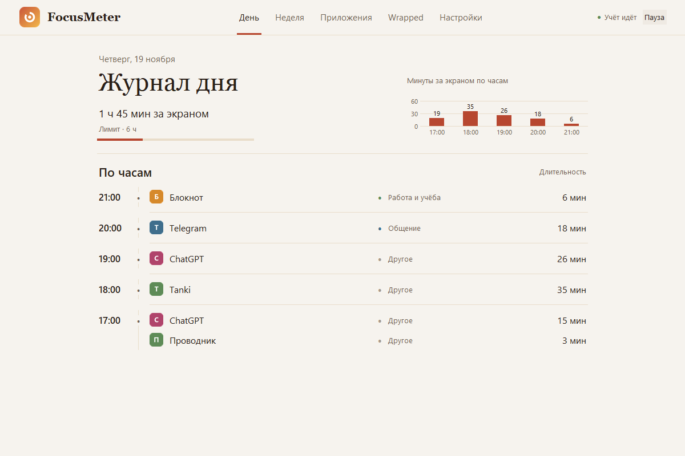

# FocusMeter

Локальный трекер экранного времени для Windows 10 и 11. Работает в трее и показывает, сколько времени за день ушло на учёбу, работу, игры и другие занятия.



## Запуск

1. Установите Python 3.10 или новее с Tkinter. При установке включите **Add python.exe to PATH**.
2. Скачайте проект через **Code → Download ZIP** и распакуйте архив.
3. Откройте **Запустить_FocusMeter.bat**. При первом запуске он установит Pillow и pystray, для этого нужен интернет.

После закрытия окна учёт продолжается. Чтобы поставить запись на паузу или выйти, откройте меню значка FocusMeter в области уведомлений Windows.

## Что посмотреть

- **День** — график активности и журнал по часам. Сверху идут свежие записи. Приложение появляется в списке после минуты активности в пределах часа. Более короткие записи входят в общий итог.
- **Неделя** — динамика за 7 и 30 дней и тепловая карта.
- **Приложения** — время в программах, поиск и смена категории. Раздел сайтов определяет знакомые сайты по заголовкам окон браузера, поэтому часть посещений может остаться нераспознанной.
- **Wrapped** — итоговые карточки за выбранный период.
- **Настройки** — тема, дневная цель, порог бездействия, лимиты приложений и экспорт CSV. При включённом лимите для отдельной программы FocusMeter предупреждает об истечении времени, затем может принудительно закрыть её. Сохраните открытые документы.

## Какие данные сохраняются

FocusMeter учитывает активное приложение и заголовок окна. История хранится на компьютере в SQLite, в файле `%LOCALAPPDATA%\FocusMeter\usage.db`. Заголовки могут содержать названия документов и вкладок. Снимки экрана приложение не делает. По умолчанию учёт приостанавливается после минуты без ввода с мыши или клавиатуры. Порог можно увеличить в настройках, например для чтения.

## Проверка из исходников

Из корня проекта на Windows с установленными зависимостями выполните:

```powershell
python tests/test_storage.py
python tests/test_journal.py
```

Проверки используют временную базу. Они охватывают повторное сохранение после ошибки, почасовую ленту, порог в одну минуту и навигацию в обеих темах.
